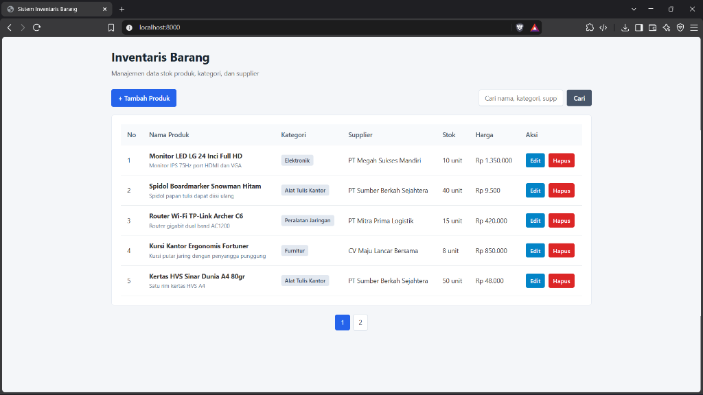
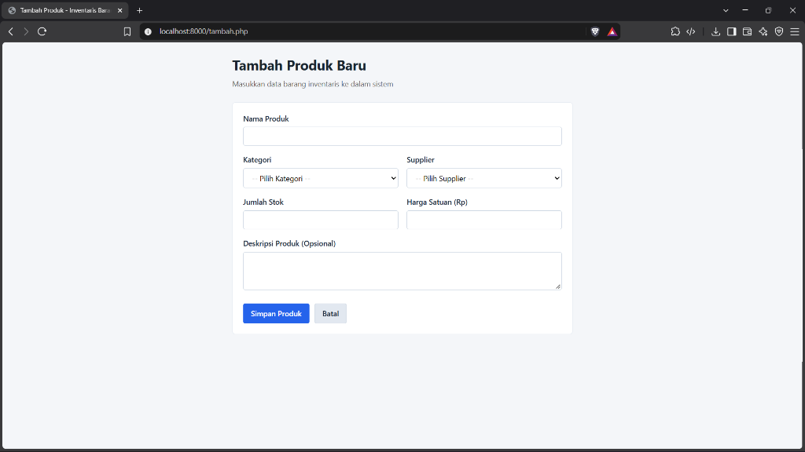
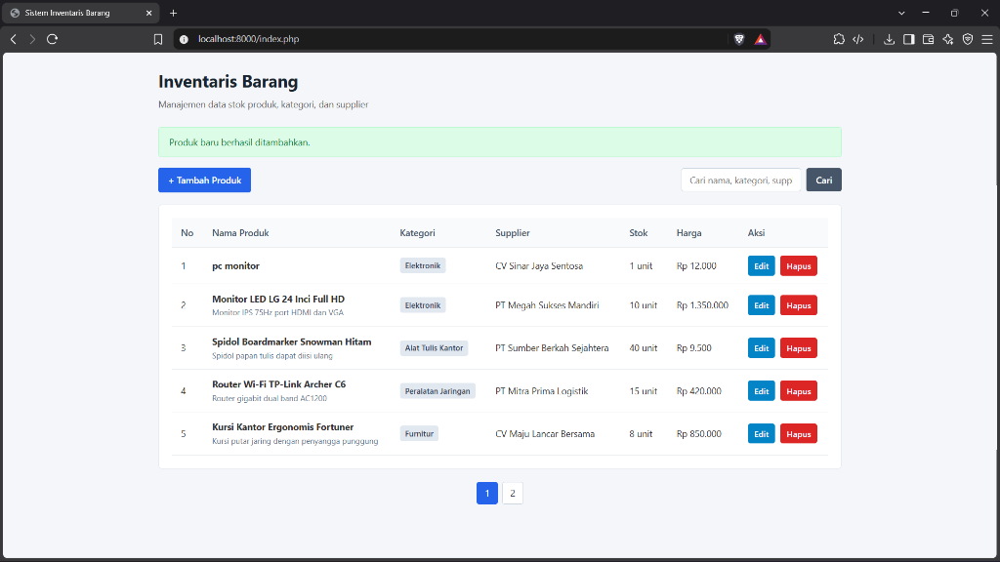
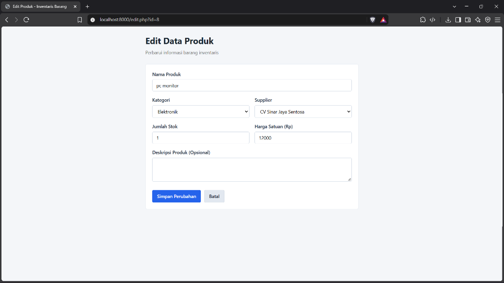
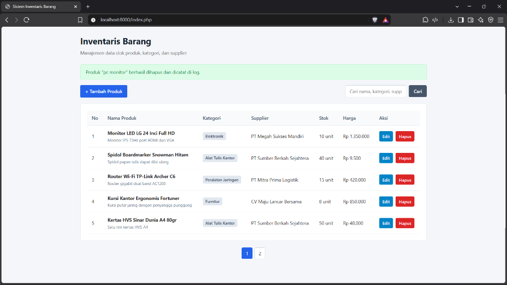

# Sistem Inventaris Barang

Aplikasi web sederhana untuk manajemen inventaris barang dan pencatatan stok yang menghubungkan data produk, kategori, dan supplier menggunakan PHP Native dan PDO MySQL.

## Fitur Utama

- **Katalog Barang**: Menampilkan data produk lengkap dengan relasi nama kategori dan supplier.
- **Pencarian & Halaman**: Memudahkan pencarian produk berdasarkan nama, kategori, atau supplier dengan pembagian halaman (pagination).
- **Pengelolaan Data (CRUD)**:
  - Penambahan produk baru dengan dropdown dinamis.
  - Pembaruan informasi produk dengan form terisi otomatis.
  - Penghapusan produk dengan konfirmasi keamanan.
- **Pencatatan Log Transaksi**: Menggunakan transaksi basis data (`PDO Transaction`) untuk mencatat riwayat penghapusan barang ke tabel log aktivitas.
- **Keamanan Data**: Menggunakan prepared statements untuk seluruh query database dan sanitasi output HTML untuk mencegah kerentanan XSS.

## Struktur Basis Data

Aplikasi menggunakan basis data `inventaris_db` dengan tabel:
1. `kategori` (id, nama_kategori)
2. `supplier` (id, nama_supplier, no_telp, alamat)
3. `produk` (id, nama_produk, id_kategori, id_supplier, stok, harga, deskripsi)
4. `log_aktivitas` (id, aktivitas, waktu)

## Tampilan Antarmuka

### 1. Daftar Produk & Relasi Data (Read & Pagination)


### 2. Formulir Tambah Produk (Dropdown Dinamis)


### 3. Notifikasi Berhasil Tambah Data


### 4. Formulir Edit Produk (Pre-filled Form)


### 5. Notifikasi Berhasil Hapus & Pencatatan Log Transaksi


## Cara Menjalankan

1. Nyalakan layanan Apache dan MySQL (misalnya melalui XAMPP atau Laragon).
2. Buka phpMyAdmin lalu impor berkas `database.sql` atau jalankan query pembuatannya.
3. Tempatkan folder proyek di dalam direktori web server (`htdocs` atau `www`), atau jalankan melalui server lokal:
   ```bash
   php -S localhost:8000
   ```
4. Akses melalui browser pada alamat:
   ```
   http://localhost:8000/
   ```
